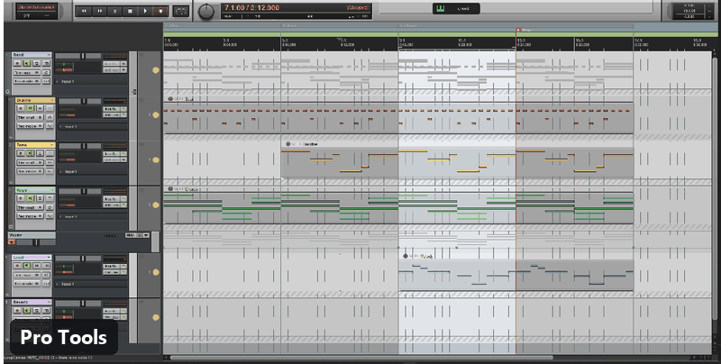
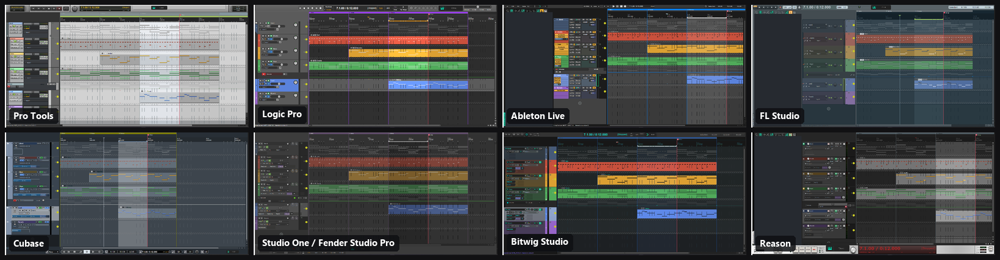

# ReaPersona

ReaPersona makes REAPER fit you: the look you prefer, the way you work, or the DAW you already know. Pick a persona for **Pro Tools, Pro Tools Intro, Logic Pro, GarageBand, Ableton Live, FL Studio, Cubase, Nuendo, Studio One / Fender Studio Pro, Bitwig Studio, Cakewalk / Sonar or Reason**, or the audio editors **Audacity** and **Adobe Audition**. You can also set it back to **stock REAPER**, keep **your own setup**, or build **your own personas** from blocks. Everything switches on the fly from one window, each project can have its own persona, and your setup can be exported, imported, or kept in sync across your computers.

*Each persona shown with the closest community look-alike theme for that DAW, to show what's possible: PRO TOOLS GOLD 2026, I Logic V3 WC, rLive, FL Studio Theme (beta 4), CubeXR, HYDRA, INQUASAR DARK MATTER and Dark_Side_Imperial. These themes are by their own authors and installed separately; without them, each persona uses a theme ReaPersona builds or REAPER's own.*

A **persona** is everything REAPER feels like: shortcuts, theme, layout, mouse behaviour and REAPER's own options. ReaPersona ships one per DAW, and you can make your own.

## What a persona changes

- **Keys.** Each DAW's default shortcuts, from its maker's own documentation. The sources are linked in `styles.json` and on each persona's Shortcuts page.
  - They live on one of REAPER's shortcut layers (Main alt-1 to alt-16), so switching is instant.
  - Keys a persona doesn't define fall through to your own shortcuts.
  - In the MIDI editor, a small script per key does the same job.
  - Keys that differ on a Mac (Pro Tools' Option+Return, Logic's Control-key commands) are stored per system.
- **Theme.** A ReaPersona theme in that DAW's colours, built on your computer (see below). Third-party themes in its likeness work too, if you have them.
- **Layout.**
  - Where the transport sits.
  - The mixer docked or in its own window, with the master on the left or right, and insert/send slots.
  - The Media Explorer docked where that DAW keeps its browser: left for Live, FL and Reason; right for Logic, GarageBand, Cubase, Nuendo, Studio One, Bitwig and Cakewalk; its own window for Pro Tools and Pro Tools Intro.
- **Mouse.**
  - The wheel as that DAW has it: scrolling and zooming with its modifiers (Shift+wheel scrolls sideways in Studio One, Reason, Live and Audacity; Ctrl+wheel zooms in Cubase, Reason and FL; Alt+wheel zooms in Pro Tools), each from the maker's documentation.
  - Drags and clicks such as Pro Tools' Smart Tool (top half selects, bottom half moves), Cubase's Alt+click split, Studio One's Ctrl+Alt slip, Alt+drag stretching in Logic, Bitwig and Audacity, and FL Studio's right-click delete.
- **Feel.**
  - Snap, ripple and follow-playhead.
  - Loop range and overlapping clips the way each DAW does them.
  - The MIDI editor docked or floating, as in that DAW (applied the next time a MIDI editor is open).
  - The smooth playhead and smooth scroll/zoom extensions, which DAW personas recommend and offer to install.
- **Toolbar.** The DAW's own toolbar takes the main toolbar's place.
- **Where things are.** Each persona lists the DAW's features with the REAPER equivalent and an Open button: Pro Tools playlists, Logic Track Stacks, Live's Session View, FL patterns, Cubase's Pool, Reason's Rack, and so on.
- **More of that DAW.** Each persona suggests other people's tools that bring more of it (Playtime, SideFX, ReaDrum Machine, Reaticulate, Lil Chordbox, the Reason Rack Plugin...) with a *Get it* button that opens ReaPack at the package, and links to keymaps others have made.

Switching away puts back everything a persona changed, so **My REAPER** is always exactly your setup. *Use this look on all my computers* (on My REAPER's page) makes that setup the same everywhere: your theme, transport and mixer places, docked windows, snap and mouse drags, carried by sync or a setup file. **Base REAPER** is REAPER 7.85's factory keys and settings, with tips.

## Setup, in one place

The first time, ReaPersona asks which DAW you're coming from and uses its persona straight away. The window has six pages: **Home** (setup), **Personas** (favourites, DAWs, your personas), **Shortcuts**, **Mouse**, **Layout**, **Themes** (yours, get more, adjust, build one), **Colours**, **Project** (defaults), **REAPER** (its options, an area per tab), **Settings** (sync, personas, scrolling & zoom, look, updates, remove) and **Help**. It works as a narrow window too; it always floats, so a persona that docks windows can't take it into a docker.

**Home** lists everything ReaPersona can use, whether you have it, and a button for each:

- **ReaPersona's own themes:** one per DAW, an approximation of its colours, built in seconds from the Default 7 theme your REAPER already has. Panels, buttons, mute/solo/arm and transport colours, track-colour strength and text all change, with all of Default 7's layout and Theme Adjuster settings kept. Nothing of Default 7 ships with ReaPersona: only the recipes do, and the theme is made from your own copy.
  - This needs Python 3 with Pillow and numpy. Home has a button that installs those two into a Python environment of ReaPersona's own (`ReaPersona/venv`), in the background, so REAPER keeps working and your system's Python isn't changed. On Debian or Ubuntu the environment needs the `python3-venv` package first.
- **Shortcut layers:** one button, on Windows, macOS and Linux, with or without Python. REAPER closes (asking about anything unsaved), the shortcuts install with a backup of your keymap, and REAPER opens again. Without Python the install is planned inside REAPER and a small script swaps it in once REAPER has closed (a batch file on Windows, a shell script on a Mac or Linux). If anything changed the keymap in between, nothing is swapped in and ReaPersona says so. To skip the restart, Help > Check and repair > Install the shortcuts can also make a keymap file to import yourself (Key Map > Import, choose **merge**).
- **Screen readers:** ReaImGui's window can't be read by NVDA, JAWS or VoiceOver, so ReaPersona also has a menu that opens at the mouse pointer: the action *ReaPersona - screen-reader menu* always opens it, and ReaPersona's own action can too (with OSARA installed it asks the first time). It covers picking a persona, undoing a switch, saving what you're using, a new project with a workflow, installing the shortcuts, syncing, the cheat sheet and its help, with results in message boxes. Installing never puts a persona key over one of OSARA's.
- **Help:** Help > How it works explains the first steps and every page (F1 opens it); Home shows the first steps until the first three are done (the fourth, more than one computer, is optional), or you hide them.
- **The startup line:** brings your persona back when REAPER starts.
- **Smooth playhead and smooth scrolling:** ReaSmoothPlayhead installs through ReaPack; Smooth Wheel Scroll comes with ReaPersona on Windows. If zooming goes the wrong way over a remote desktop (Chrome Remote Desktop sends the wheel in odd-sized steps, which Smooth Wheel Scroll takes for a touchpad), untick *Reverse touchpad horizontal zoom* in its settings. On a Windows precision touchpad, Shift + two-finger swipe reaches REAPER as a sideways scroll without Shift, so a pinch (which arrives as Ctrl+wheel) is the gesture to give zoom to.
- **Themes by other people:** each one the personas can use. *Install* downloads it from where its author shares it (the REAPER Stash or the author's own link) and takes it in; *Get it* opens the page for the few that need a browser (paid, or a sign-in).
  - Each persona's page has *Install <DAW>'s recommended look* and *Install all*; switching to a persona offers its look once.
  - Packs are handled for you: .zip and .rar packs (even one inside another), unzipped themes with their image folders, the fonts a theme needs (installed for your account on your yes, no administrator), a theme's own scripts (added to the Actions list on your yes), and mod packs, whose mods become theme versions to click (rLive's ModPack gives five). On Linux, packs need `unzip` (or `bsdtar` or `7z`; `unrar` or `bsdtar` for .rar), and ReaPersona says which is missing.

**Drag and drop:** drop files onto ReaPersona's window to add them.
- Themes, either `.ReaperThemeZip`/`.ReaperTheme` files or a theme pack `.zip` straight from the download.
- Toolbars (`.ReaperMenu`).
- Keymaps (`.ReaperKeyMap`), which become a persona of their own on a free shortcut layer.
- Shared personas.

## Also in the window

- **Search everything** (Ctrl+K, Cmd+K on a Mac, in the top bar when the window is wide enough): personas, shortcuts in every persona ("split" shows each DAW's key), where a DAW's feature is in REAPER, themes, settings and pages.
- **New project like <DAW>:** each persona's page starts a project with that DAW's usual tracks, buses and sends (REAPER's own plugins).

- **Shortcut editor:** your persona's keys to leave out, change (press the new keys) or add, a key of your own for any of REAPER's actions, scripts or custom actions, and *Every shortcut*: every persona's keys and your keymap's, the most used first, filtered by type, source and section.
- **Mouse and trackpad editor:** your persona's wheel, trackpad swipe, drags and clicks by REAPER's own names, each to leave out, change or remove, your own on any of REAPER's 88 mouse contexts, and every mouse action REAPER and the personas have, grouped by where you click.
- **Layout designer:** drag the Mixer, Media Explorer, Transport and MIDI editor into REAPER's docks, the transport's places, their own window or closed, with tabs in the order you set; it starts from the persona's own layout.
- **Other windows:** the Actions list, Undo History, Region/Marker Manager, Track Manager, Routing Matrix and REAPER's other windows, open or closed, docked or in their own window with their place and size, in any persona and My REAPER's look. Taking one out of a docker uses a window set of ReaPersona's, added at REAPER's next restart.
- **Favourites:** the star on any DAW's or persona's card puts it on Personas > Favourites. Setting up ReaPersona stars My REAPER and the DAW you pick.
- **Make your own persona from the tabs:** *New persona* (or *Edit* on any persona), then choose each part where it lives: its shortcuts (Shortcuts), its mouse (Mouse), each part of its layout (Layout: the mixer from one DAW, the transport from another...), its theme (Themes), its colour look (Colours), what a new project gets (Project) and groups of REAPER settings (Settings > REAPER tweaks, *In my persona*). A bar over every tab shows it, with *Try it* and *Save*.
  - Each part comes from whichever persona you pick for it, or stays as yours; untick any single line (a key, a mouse drag, a layout setting) to leave just that out.
  - One DAW's shortcuts are ready straight away. Shortcuts from several DAWs get a layer of their own, installed with one click (REAPER restarts).
  - Or make one from every tab: *New persona*, then *Use in my persona* on a DAW (or just its keys, mouse or mixer), a theme, a colour look or a group of REAPER tweaks. A bar at the top of every tab shows what's in it, with *Save*.
  - *Edit* on any persona's page opens it the same way: one you built is saved over, a DAW persona becomes your own version.
- **A persona per project:** *Use for this project* on a persona's page saves it in the project. With *Switch persona with the project* on (Settings), opening that project or switching to its tab switches persona, and projects without one can keep the one in use or switch to one you pick. REAPER keeps many options per project (snap, ripple, the metronome, the mixer layout), and a persona's changes are put back in the tab they were made in.
- **Browse:** the REAPER Stash's newest, most popular and top-rated themes, key maps, custom actions and templates. *Add* downloads one and takes it in like a dropped file; anything behind a sign-in opens its page instead.
- **Import from another DAW:**
  - finds the DAWs installed on your computer;
  - turns your own Cubase/Nuendo key commands into a persona;
  - makes a ReaPersona theme from an Ableton Live theme (`.ask`).
- **What a persona may change:** switch off the parts you want to keep as they are, whatever persona you use: mixer docking, mixer layout, transport, Media Explorer, toolbar, mouse, snap/ripple.
- **REAPER preferences** (REAPER > Preferences): fades and crossfades, zoom centres, new track and send volume, automation mode, the prompt after recording and solo dimming, in any persona; they go in at REAPER's next restart.
- **REAPER** (its own tab, an area per sub-tab): about 60 of REAPER's and SWS's options in groups, switched live: playback and scrolling, editing, recording (count-in, recording over items, lanes), view, colours and icons (SWS auto-colour, auto icons and layouts), automation, monitoring and mixer. *In my persona* makes a group, as you set it here, part of the persona you're making.
- **Theme adjuster:** pops out into its own window; REAPER's own Theme Adjuster is one click away.

- **Workflows:** a persona can set up a new project for a kind of session: a whole project template (tracks with their FX, routing and folders, sample rate, recording format, render settings, tempo, markers) or just a sample rate, tempo, time signature, grid and starter tracks (Project defaults), plus a window set and REAPER's options for that kind of work. Choose it in a new project, or press *New project with it*, and it's ready. The starters (voiceover at 48 kHz, a podcast, music at 44.1 kHz, live looping, mixing, mastering, video post) can go straight on top of whichever persona you use: pick one under *Workflow on top* on the Personas page (or from the screen-reader menu) and Pro Tools keeps its keys while new projects get the voiceover setup. A workflow on top brings only its REAPER settings and its project part, and switching it off puts the settings back. The Project tab can also put them into a persona of your own, or make your own. The quickest way to make your own: set a project up the way that session wants it, then *Save what I'm using...* and say yes to "Make it a workflow too?". Each computer can keep its own track inputs for a workflow (*Keep these inputs on this computer*), and a new project says which of its plug-ins a computer hasn't got.
- **Your other computers** (Settings > Sync): *Save to a file* puts your personas, presets, ReaPersona's settings and the smooth scroll/zoom and playhead extensions' settings in one file; *Load a file* (or dropping it on the window) takes them in on another computer. Or pick a folder your computers share (Syncthing, Google Drive, Dropbox...) on each of them: each computer keeps its own file there, and the newest change to each persona or setting wins. Themes, and where each computer's windows sit, stay as they are. *Advanced* adds REAPER itself, part by part: preferences, other scripts' settings, shortcuts, mouse, menus, toolbars and window sets, FX chains and templates, your own scripts and JSFX, themes, and ReaPack's repositories and packages (what another computer has is one click to install).
- **Feedback:** report a bug or ask for something from inside ReaPersona: saved in your sync folder and/or opened as a GitHub issue.
- **Save what I'm using:** the persona in use the way you like it, with its theme, layout and settings, saved under a name. You can share it as a file.
- **Themes:** every theme on your computer. *Try* wears one for 20 seconds (keep it or it goes back), *Use* applies one on its own, *Add to...* makes it one of any persona's theme versions.
- **Colours** (its own tab): colour a whole project at once, from StudioSync's colour system. Tracks by gradient, folder, instrument (from the names: drums, bass, guitars, keys, synths, vocals...), stripes, rainbow or confetti; items by section, along the song, lane, takes or kind (MIDI, recordings); regions by section (verse, chorus... keep their colours in every song) or along the song. Seven palettes or two colours of your own, your own colours for each instrument, folder and section, a preview bar of what each will do, and *Try it first*: Keep it, or Put it back to exactly what you had. Colours go with personas: *Save what I'm using...* keeps the look with the persona, *In my persona* on the Colours tab puts the look in the persona you're making, switching to one brings its look back (yours returns when you switch away), and a workflow with colours colours the tracks of each new project it sets up.
- **Theme versions:** each persona's page shows all its theme versions as buttons (Pro Tools has nine), with *Get it* links for the ones you don't have yet. Click one to make it that persona's theme.
- **Adjust:** a theme's own settings, layouts and colours, live.
- **Build one (themes):** a theme from several (layout, colours and parts from different themes).
- **Updates:** Settings > Updates checks GitHub for a newer ReaPersona and updates it (through ReaPack when ReaPack installed it).
- **Settings:** what personas may change, a persona per project, the smooth playhead and scroll/zoom extensions, ReaPersona's own look, and **Remove ReaPersona**: My REAPER comes back, and the startup block, ReaPersona's actions, settings, shortcut layers and toolbars come out (your personas, presets and themes stay). Then uninstall it in ReaPack.
- **Cheat sheets:** every key and setting of a persona on one printable page.

## On a Mac

REAPER treats Ctrl as Cmd, so the personas should work unchanged, and keys show as Cmd and Option. Keys that differ on a Mac (Pro Tools' Option+Return, Logic's Control-key commands, Option-drag to copy in Ableton, Bitwig and Reason) are stored separately. Theme building needs `python3`; the shortcut install uses it when it's there and a shell script when it isn't. Smooth Wheel Scroll's bundled build is Windows-only; see its own page for macOS. Tested on an Apple-silicon Mac (macOS, REAPER 7.86): personas, sync with Windows computers, and the shortcut install both ways.

## Install

### New to REAPER?

One installer does it all: REAPER, ReaPack, ReaImGui, js_ReaScriptAPI and SWS (skipping what you already have, each from its official source), then ReaPersona. It asks which music app you're coming from and leaves REAPER set up as that app, shortcuts included, with that DAW's recommended look-alike theme downloaded and on (REAPER restarts once at the end). Enter at the question means plain REAPER.

- **Windows:** double-click [`installer/Install ReaPersona (Windows).cmd`](installer/), or in PowerShell:
  `$f="$env:TEMP\reapersona_install.ps1"; iwr -UseBasicParsing "https://raw.githubusercontent.com/FmsJay/ReaPersona/main/installer/install_windows.ps1" -OutFile $f; powershell -NoProfile -ExecutionPolicy Bypass -File $f`
- **Mac:** double-click [`installer/Install ReaPersona (Mac).command`](installer/) (if macOS blocks it: System Settings > Privacy & Security > Open Anyway), or in Terminal:
  `curl -fsSL "https://raw.githubusercontent.com/FmsJay/ReaPersona/main/installer/install_mac.sh?$(date +%s)" | bash`
- **Linux** (a terminal on the computer's own desktop; everything goes in your home folder, no sudo):
  `curl -fsSL "https://raw.githubusercontent.com/FmsJay/ReaPersona/main/installer/install_linux.sh?$(date +%s)" | bash`

To answer the question up front: add `-Persona logic` to the Windows line, or put `RP_PERSONA=logic` before `bash` on a Mac or Linux (any persona id: `pro_tools`, `ableton`, `fl_studio`... `base_reaper` is plain REAPER).

### Already using REAPER

1. In REAPER, open **Extensions > ReaPack > Import repositories…** and paste:
   `https://github.com/FmsJay/ReaPersona/raw/main/index.xml`
2. In **Extensions > ReaPack > Browse packages**, install **ReaPersona**.
3. ReaPersona needs:
   - **ReaImGui** and **js_ReaScriptAPI** (ReaPack: ReaTeam Extensions)
   - **SWS** (sws-extension.org)
4. Open **ReaPersona** (**Extensions > ReaPersona**, **View > ReaPersona**, or the Actions list), open **Home**, and press **Set up everything**.
   The menu items come from a small extension ReaPack installs with ReaPersona (64-bit Windows, macOS and Linux), after REAPER's next start.
   REAPER's Actions list keeps only ReaPersona and the actions its keys use. Settings > "Every ReaPersona action in REAPER's Actions list" brings back
   the persona switches ("use Ableton Live" and the rest) for your own shortcuts and toolbar buttons.

## Themes and credits

ReaPersona's own themes are built on your computer from REAPER's Default 7 (© Cockos), which every REAPER install includes.

Themes by other authors aren't redistributed: no licence means their authors keep the rights. The Cakewalk persona's BandLab recolour is built on mawi's Echolot (CC BY-NC-SA 4.0). [THEMES.md](THEMES.md) credits each one and links to its page, and the Setup page does the same with a button. Download a theme, then drop it onto the window.

Thanks also to:
- the authors of the extensions ReaPersona works with: SWS, ReaImGui, js_ReaScriptAPI, ReaPack, ReaSmoothPlayhead (DsgDnB), Helgobox/Playtime;
- **Smooth Wheel Scroll** by bobo198504, MIT licence: ReaPersona carries its Windows build unchanged (`extensions/`, with the licence) so Setup can install it in one click. Source: https://github.com/bobo198504/SmoothWheelScroll;
- the tools each persona suggests, by their authors: Suzuki (ReaDrum Machine), Conceptual Machines (SideFX), Jason Tackaberry (Reaticulate), FTC (Lil Chordbox), MPL, edkashinsky (ReAbleton), Reapertips, smandrap, pandabot (ChordGun), Navelpluisje (ReaSonus Native), git-moss (DrivenByMoss4Reaper);
- MPL's RS5k step sequencer.

## Adding a DAW persona

DAW personas are data in `styles.json`. Each key is `[key, REAPER command id or named id, what the DAW calls it]`, and the feel uses the kinds documented at the top of that file. Run `validate.py` after editing (press *Check* on Help > Check and repair first, so it can compare against your REAPER), then install the shortcuts.

## Changes

See [CHANGELOG.md](CHANGELOG.md).

## Licence

GPL-3.0. The DAW names belong to their makers; ReaPersona isn't affiliated with any of them.
