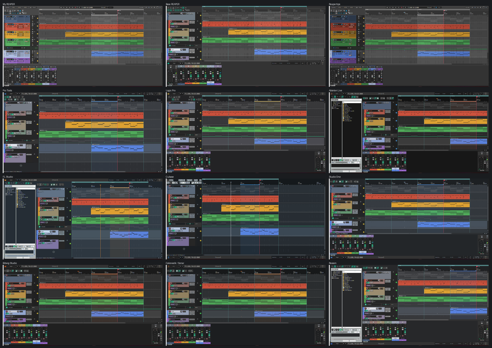

# ReaPersona

Make REAPER feel like the DAW you know: **Pro Tools, Logic Pro, Ableton Live, FL Studio, Cubase, Studio One, Bitwig Studio, Cakewalk / Sonar or Reason**. You can also set it back to **stock REAPER**, use **your own setup**, or mix them into **your own profiles**. Everything switches on the fly from one window.

## What a style changes

- **Keys.** Each DAW's default shortcuts, from its maker's own documentation. The sources are linked in `styles.json` and on each style's Shortcuts page.
  - They live on one of REAPER's shortcut layers (Main alt-1 to alt-16), so switching is instant.
  - Keys a style doesn't define fall through to your own shortcuts.
  - In the MIDI editor, a small script per key does the same job.
- **Theme.** A ReaPersona theme in that DAW's colours, built on your computer (see below). Third-party themes in its likeness work too, if you have them.
- **Layout.**
  - Where the transport sits.
  - The mixer docked or in its own window, with the master on the left or right, and insert/send slots.
  - The Media Explorer docked where that DAW keeps its browser: left for Live, FL and Reason; right for Logic, Cubase, Studio One, Bitwig and Cakewalk; its own window for Pro Tools.
- **Feel.**
  - Snap, ripple and follow-playhead.
  - Mouse behaviours such as Pro Tools' Smart Tool and FL Studio's right-click delete.
  - The smooth playhead and smooth scroll/zoom extensions, which DAW styles recommend and offer to install.
- **Toolbar.** The DAW's own toolbar takes the main toolbar's place.
- **Where things are.** Each style lists the DAW's features with the REAPER equivalent and an Open button: Pro Tools playlists, Logic Track Stacks, Live's Session View, FL patterns, Cubase's Pool, Reason's Rack, and so on.

Switching away puts back everything a style changed, so **My REAPER** is always exactly your setup. **Base REAPER** is REAPER 7.85's factory keys and settings, with tips.

## Setup, in one place

The **Setup** page lists everything ReaPersona can use, whether you have it, and a button for each:

- **ReaPersona's own themes:** one per DAW, built in seconds from the Default 7 theme your REAPER already has, in that DAW's colours. Panels, buttons, mute/solo/arm and transport colours, track-colour strength and text all change, with all of Default 7's layout and Theme Adjuster settings kept. Nothing of Default 7 ships with ReaPersona: only the recipes do, and the theme is made from your own copy.
  - This needs Python 3 with Pillow and numpy. Setup has a button that installs those two.
- **Shortcut layers:** with Python, close REAPER and run `install_shortcuts.py`. Or make a keymap file and import it in the Actions window (Key Map > Import, choose merge).
- **The startup line:** brings your style back when REAPER starts.
- **Smooth playhead and smooth scrolling:** ReaSmoothPlayhead installs through ReaPack.
- **Themes by other people:** each one the styles can use, with a *Get it* button to its author's page.

**Drag and drop:** drop files onto ReaPersona's window to add them.
- Themes, either `.ReaperThemeZip`/`.ReaperTheme` files or a theme pack `.zip` straight from the download.
- Toolbars (`.ReaperMenu`).
- Keymaps (`.ReaperKeyMap`), which become a style of their own on a free shortcut layer.
- Shared styles and presets.

## Also in the window

- **Presets:** a style the way you like it, with its theme, layout and settings, saved under a name. You can share them as a file.
- **Mix and match:** one style's keys, another's layout and feel, and any theme, saved as a profile.
- **Themes:** every theme on your computer. *Use* applies one on its own; *Add to* puts it in a style's Theme list.
- **Adjust:** a theme's own settings, layouts and colours, live.
- **Merge:** build a theme from several (layout, colours and parts from different themes), or a new style from two styles' shortcuts.
- **Settings:** continuous scrolling, follow-playhead, smooth seek, smooth playhead and scroll/zoom, and ReaPersona's own look.
- **Cheat sheets:** every key and setting of a style on one printable page.

## Install

1. In REAPER, open **Extensions > ReaPack > Import repositories…** and paste:
   `https://github.com/FmsJay/ReaPersona/raw/main/index.xml`
2. In **Extensions > ReaPack > Browse packages**, install **ReaPersona**.
3. ReaPersona needs:
   - **ReaImGui** and **js_ReaScriptAPI** (ReaPack: ReaTeam Extensions)
   - **SWS** (sws-extension.org)
4. Run **ReaPersona** from the Actions list, open **Setup**, and press **Set up everything**.

## Themes and credits

ReaPersona's own themes are built on your computer from REAPER's Default 7 (© Cockos), which every REAPER install includes.

Themes by other authors aren't redistributed: no licence means their authors keep the rights. [THEMES.md](THEMES.md) credits each one and links to its page, and the Setup page does the same with a button. Download a theme, then drop it onto the window.

Thanks also to:
- the authors of the extensions ReaPersona works with: SWS, ReaImGui, js_ReaScriptAPI, ReaPack, ReaSmoothPlayhead, Helgobox/Playtime;
- MPL's RS5k step sequencer.

## Adding a style

Styles are data in `styles.json`. Each key is `[key, REAPER command id or named id, what the DAW calls it]`, and the feel uses the kinds documented at the top of that file. Run `validate.py` after editing (press *Check* in the Check page first, so it can compare against your REAPER), then install the shortcuts.

## Licence

GPL-3.0. The DAW names belong to their makers; ReaPersona isn't affiliated with any of them.
