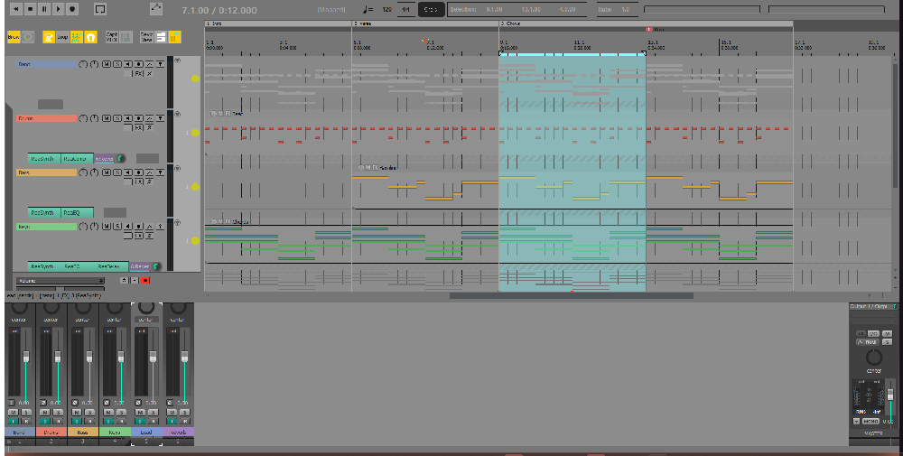

# ReaPersona

Make REAPER feel like the DAW you know: **Pro Tools, Logic Pro, Ableton Live, FL Studio, Cubase, Studio One or Bitwig Studio**. Or set it back to **stock REAPER**, or to **your own setup**. You can switch on the fly and save your own presets. Themes can be adjusted and merged live.



## What a style changes

- **Keys.** Each DAW's default shortcuts, taken from its maker's own documentation (sources are linked in `styles.json` and on each style's Shortcuts page).
  - They live on one of REAPER's shortcut layers (Main alt-1 to alt-16), so they switch instantly.
  - Keys a style doesn't define fall through to your own shortcuts.
  - In the MIDI editor, which has no layers, a small script per key does the same job.
- **Theme.** A REAPER theme made in that DAW's likeness. You need to have it installed (see [THEMES.md](THEMES.md)).
- **Layout.** Where the transport sits, the mixer docked or in its own window, the mixer master on the left or right, and insert/send slots. The Media Explorer is docked where that DAW keeps its browser: left for Live and FL, right for Logic, Cubase, Studio One and Bitwig, its own window for Pro Tools.
- **Feel.** Snap, ripple editing and follow-playhead, plus mouse behaviours such as Pro Tools' Smart Tool (the bottom half of a clip selects time) and FL Studio's right-click delete in the piano roll.
- **Toolbar.** The DAW's own toolbar takes the main toolbar's place.

Switching away puts back everything a style changed, so **My REAPER** is always exactly your setup. **Base REAPER** is REAPER 7.85's factory keys and settings, with tips.

## Also in the window

- **Presets:** a style plus your theme and settings, saved under a name.
- **Themes:** theme styles, every theme on your computer, *Add a theme…* for ones you've downloaded, and where to find more.
- **Adjust:** a theme's own settings, layouts and colours, live. You can keep your version.
- **Merge:** build a theme from several (layout from one, colours from another, faders and knobs from a third), or a new style from two styles' shortcuts.
- **Settings:**
  - Continuous scrolling, follow-playhead and smooth seek.
  - Smooth playhead and smooth scrolling/zoom. ReaPersona installs ReaSmoothPlayhead through ReaPack, and DAW styles that feel that way recommend these.
  - ReaPersona's look.
- **Cheat sheets:** every key and setting of a style on one printable page.
- **Share:** a style as one file, for someone else to import.

## Install

1. In REAPER, open **Extensions > ReaPack > Import repositories…** and paste:
   `https://github.com/FmsJay/ReaPersona/raw/main/index.xml`
2. In **Extensions > ReaPack > Browse packages**, install **ReaPersona**.
3. ReaPersona needs:
   - **ReaImGui** (ReaPack: ReaTeam Extensions)
   - **SWS** (sws-extension.org)
   - **js_ReaScriptAPI** (ReaPack: ReaTeam Extensions)
4. Run **ReaPersona** from the Actions list.

### Installing the shortcuts (once, and after adding a style)

REAPER reads its keymap only when it starts, so the shortcut layers go in once. There are two ways:

- **With Python 3:** close REAPER and run `install_shortcuts.py` in ReaPersona's folder, then start REAPER. This route also installs the styles' toolbars and keeps a dated backup of your keymap.
- **Without Python:** on ReaPersona's **Check** page, press *Make the keymap file*. Then in the Actions window choose **Key Map > Import…**, pick `ReaPersona shortcuts.ReaperKeyMap`, and choose *merge*. This route doesn't install toolbars, so styles keep your own.

REAPER forgets which shortcut layer was on when it restarts. To bring it back automatically, add this to `Scripts/__startup.lua`:

```lua
dofile(reaper.GetResourcePath() .. "/Scripts/ReaPersona/Workflow/reapersona_core.lua").restore_last()
```

## Themes

No themes ship with ReaPersona. They belong to their authors, and most don't allow redistribution. [THEMES.md](THEMES.md) lists the themes each style uses and where to get them.

Install a theme the normal way (drop it in REAPER's `ColorThemes` folder) or with **Themes > Add a theme…**. A style picks up its themes as soon as they're there. Themes you merge or edit stay on your computer.

Some styles also use toolbar sets from the CubicPack and CLogic theme packs (Cubase and Logic). Put their `.ReaperMenu` files in ReaPersona's `toolbars` folder before running `install_shortcuts.py`. Without them, those styles keep your toolbar.

## Adding a style

Styles are data in `styles.json`. Each key is `[key, REAPER command id or named id, what the DAW calls it]`. Run `validate.py` after editing (it checks every key and command against your REAPER: press *Check* in the Check page first), then install the shortcuts.

## Licence

GPL-3.0. The DAW names belong to their makers; ReaPersona isn't affiliated with any of them.
